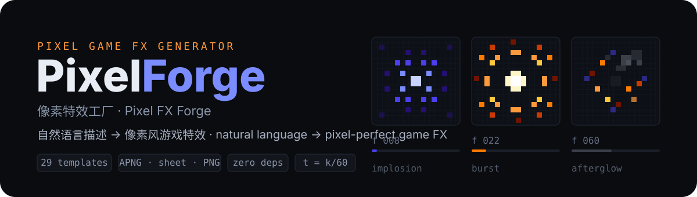
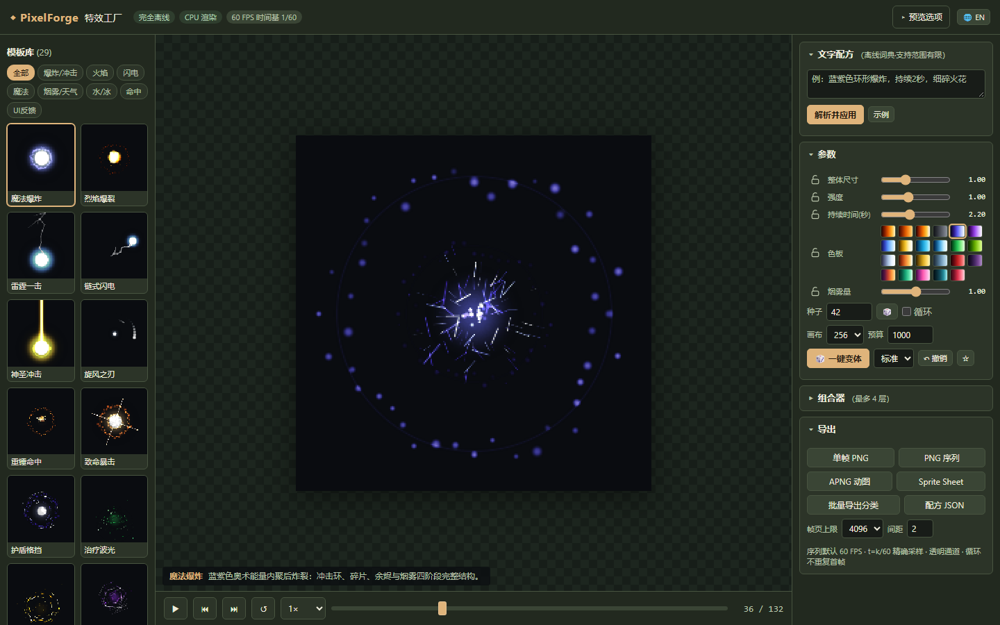
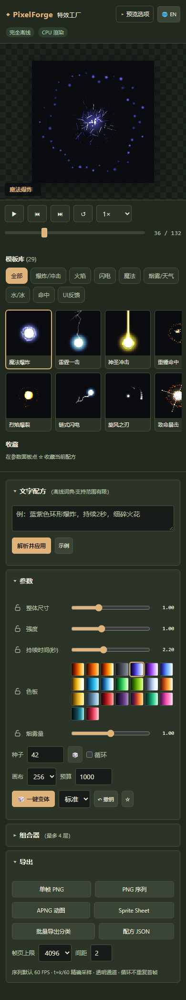

[简体中文](README.md) · **English**

# PixelForge · Pixel effects workshop

Make pixel effects offline: choose a template, tune a recipe, and preview or export transparent assets from the same deterministic timeline.



[](https://github.com/LINYEANSHU/pixelforge/actions/workflows/ci.yml)
[](LICENSE)

## In the app



<details>
<summary>Show the mobile layout</summary>



</details>

## Start

Use Node.js 18+; no dependency installation is needed:

```sh
node server.js 8347
```

Open `http://127.0.0.1:8347`. On Windows, double-click `启动PixelForge.bat`. You can also open `index.html` or the [standalone build](dist/pixelforge-standalone.html) offline. Automatic launch uses a separate browser profile with GPU disabled; the main preview uses CPU rasterization.

First result: select a template → tune intensity, duration or palette → pause and scrub → export a PNG frame.

## Recipe to asset

- **29 templates in eight categories**: explosions, fire, lightning, magic, smoke/weather, water/ice, hits and UI feedback.
- **Three ways to edit**: parameters, randomized variants that respect locks, and bilingual text recipes. Text recipes use an offline dictionary and rules for supported descriptions, with no online model.
- **A reproducible timeline**: seed and frame determine the result. Preview, seeking and export share the same evaluation path, sampled at `t = k/60`.
- **Up to four layers**: independent time windows, offsets and scale; favorites, undo and recipe import/export.
- **A usable phone layout**: preview, templates and parameters stack vertically. Paused frames redraw only after changes; displayed fields stay in sync with templates and undo.

## Export

| Format | Output |
|---|---|
| PNG frame | Current frame with transparency |
| PNG sequence ZIP | Frames and `timeline.json` |
| Sprite Sheet | Paged PNGs and Aseprite-compatible JSON |
| APNG | Transparent animated PNG |
| Recipe JSON | Seed, layers and parameters for later reproduction |

Export reports progress and supports cancellation. HTTP mode uses a Worker; `file://` uses chunked CPU work on the main thread to avoid offline Worker-loading failures. Loops omit the duplicate endpoint, and oversized sheets split into pages.

## Verify and develop

```sh
node tests/run-tests.cjs
node build.cjs
```

The 18-test suite covers determinism, preview/export pixel agreement, alpha, paging, recipe round trips, cancellation and long loops. The build command regenerates the standalone file. Recent UI checks include phone previews, field synchronization and a real PNG download; machine-specific frame rates are not universal performance claims.

Rendering cost depends on dimensions, particle budget and frame count. The experimental WebGL backend is not connected to the main UI and was not benchmarked in this update. GIF and video export are not implemented.

## Documentation and license

[Export format](docs/导出格式.md) · [License inventory](docs/LICENSES.md) · [Third-party notices](NOTICE)

Project code is [MIT](LICENSE). Design references and their attribution remain in `NOTICE`.

## Contributors

- [LINYEANSHU](https://github.com/LINYEANSHU)
