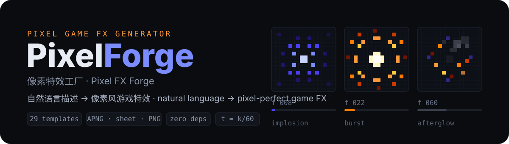

<p align="center">
  
</p>

<p align="center">
  <a href="https://github.com/LINYEANSHU/pixelforge/actions/workflows/ci.yml"></a>
  <a href="./LICENSE"></a>
  
</p>

<p align="center">简体中文 ｜ <a href="./README.en.md">English</a></p>

---

**PixelForge 特效工厂**是一个完全离线的 2D 像素游戏特效生成器：用一句自然语言描述（或从 29 个模板中挑选），在浏览器里 60 FPS 逐帧预览，再导出 APNG、精灵表、PNG 序列与配方 JSON。它是一个可以玩的特效实验室——不是视频剪辑软件，也不是固定 GIF 的展示页。

运行时不依赖任何在线 API，不请求任何网络资源，浏览器端零运行时依赖。

## 打开即玩

启动后立即播放完整四阶段的「魔法爆炸」：**内聚起势 → 白炽爆发 → 颗粒冲击环扩散 → 碎片/余烬/烟雾余波**。左侧模板库（29 个生成器、8 大类），中间最近邻放大的像素风大预览，右侧参数面板与导出，底部时间轴。

**三种调特效的入口**

1. **模板 + 参数**：尺寸/强度/持续时间/方向/色板，每个参数可🔒锁定。
2. **一键变体**：合理扰动参数与种子，保留锁定项；轻微/标准/狂野三档，支持撤销与收藏。
3. **文字配方**：`蓝紫色环形爆炸，持续2秒，细碎火花，透明背景` 或 `blue-violet ring explosion, 2s, fine sparks` —— 双语离线词典 + 规则映射，解析结果以字段芯片展示，无法理解的部分明确提示。**不声称支持任意自然语言，不调用在线模型，不执行文本内容。**

其他亮点：**组合器**（最多 4 层，每层独立时间窗/偏移/缩放）、**测试场**（前摇 → 命中 → 后摇的攻击演示，可关震屏、抑制剧烈闪烁）、**中英双语 UI**（默认跟随浏览器语言，顶栏 🌐 一键切换）。

## 快速开始

```bash
node server.js 8347    # 打开 http://127.0.0.1:8347
```

其他方式：直接用浏览器打开 `index.html`（file:// 下同样可用，导出自动回退主线程）；单文件版 `dist/pixelforge-standalone.html`；Windows 可双击 `启动PixelForge.bat`。Node.js 仅用于启动本地服务器与工具链（建议 18+），无需安装依赖、无需构建。

## 29 个模板（8 大类）

爆炸/冲击 · 火焰 · 闪电 · 魔法 · 烟雾/天气 · 水/冰 · 命中 · UI 反馈。

每个模板都有**结构化的阶段设计**（起势/爆发/扩散/余波，或持续发射/形态变化/消散），由冲击环、光束、弧光、碎片、轨迹、噪声漂移等图层组合而成——换色板不构成新模板。

## 导出（全部真实实现）

| 格式 | 内容 |
|---|---|
| 单帧 PNG | 当前帧，RGBA 直通 alpha，无棋盘格/黑底混入 |
| PNG 序列 | ZIP 内逐帧 PNG + `timeline.json`，默认 60 FPS |
| Sprite Sheet | 多页 PNG + Aseprite 兼容 JSON（帧矩形/顺序/锚点/帧率/时长/循环/分页） |
| APNG 动图 | 单文件动画 PNG，透明通道 |
| 配方 JSON | `.pfx.json`，可加载恢复（非法配置被拒绝） |

关键规则：采样时间 **t = k/60**（`timebase: "1/60"`）精确采样；**循环导出不重复首尾帧**；页边长默认上限 4096，超限自动分页并记录 padding 与锚点；导出在 **Web Worker** 中逐帧编码、即编即释（file:// 下回退主线程分片），**进度条 + 取消**实时可用。GIF 与视频为后续项。

## 架构一览

- **确定性纯函数求值**：所有粒子状态 = f(种子, 层, 槽)，无模拟历史。**同版本 + 同种子 + 同帧 = 逐位一致**；拖动时间轴、逐帧步进与导出共享同一求值路径。
- **固定时间基 1/60**：运动轨迹与衰减是时间的连续函数（解析积分），t = k/60 精确采样，60 FPS 是采样目标而非低帧率步进；循环效果帧 N ≡ 帧 0 逐位一致。
- **CPU 光栅化**：颜色缓冲 + 加法光缓冲双缓冲合成，TypedArray 预分配复用（256px ≈ 196KB），逐帧零对象分配，最近邻放大保持像素感。
- **Web Worker 导出**：逐帧编码后立即释放缓冲，只保留压缩字节；主线程回退路径同为分片异步。
- **种子化 RNG**：全部随机量由种子派生，配方 JSON 记录种子即可完整复现。

## 性能与预算（实测见 `docs/性能报告.md`）

- 最重模板 256px 实测 **2.87ms/帧**（60 FPS 预算的 17%）；导出 **503 帧/秒**。
- 默认 1000 活动粒子预算（64..4000 可调），超限按层比例收缩。
- 预览内存常态 <50MB；导出峰值 ≈ 页缓冲 64MB + 压缩字节。

## GPU 加速（实验性）

`src/core/raster-gpu.js` 是按原架构 Renderer 接口实现的实验性 WebGL2 后端（双批次双 FBO、实例化绘制），**默认路径仍为 CPU，GPU 后端未接入主 UI**。`bench/gpu-bench.html` 提供同页对比基准；该项目实测数据（加速比、像素差 MAE）见 `docs/GPU加速测试报告.md`——来自特定实机，**需在你的硬件上实测验证**。应用本身不依赖 GPU，CPU 模式下完全离线可用。

## 测试

```bash
node tests/run-tests.cjs     # 18/18 通过
```

覆盖：同种子逐位复现、seek 一致性、导出 PNG 解码像素 == 直接渲染、60FPS 帧数与时间基、透明通道、精灵表分页、配方 JSON 往返、组合器往返、非法配置拒绝、取消清理、3600 步长循环无增长、循环接缝逐位一致、断网静态扫描、双语配方解析、粒子预算钳制。

## 目录结构

```
index.html / styles.css        主界面（系统字体，无外部资源）
server.js / 启动PixelForge.bat 本地服务器与一键启动
build.cjs                      打包 dist/pixelforge-standalone.html
src/core/                      引擎（pf/rng/palette/raster/raster-gpu/layers/effect/templates/parser/variant/stage）
src/core/export/               PNG 编码 / ZIP / APNG / 导出任务（Worker 与 Node 共用）
src/ui/                        主控制器 app.js 与双语词典 i18n.js
src/export.worker.js           导出 Worker
tests/run-tests.cjs            18 项自动化测试
tools/                         基准与样例生成脚本
samples/                       接触表 / 单帧 / 全套导出样例 / 读取示例代码
docs/                          性能报告 / 压力测试报告 / 导出格式 / 生成器接口 / 许可清单
```

## 参考与致谢

- 本项目的玩法与效果思路在设计中参考了 [patch-gg/pixelfx](https://github.com/patch-gg/pixelfx)（MIT）：仅参考其**设计概念**（颜色+加法光双缓冲、全种子化确定性、Aseprite 风格 sheet 元数据组织），未复制其任何代码与字体。详见 `NOTICE` 与 `docs/LICENSES.md`。
- 技术栈：原生 JavaScript + Web Worker，零运行时依赖；字体使用操作系统系统字体栈。

## 许可

[MIT](./LICENSE) © 2026 LINYEANSHU
